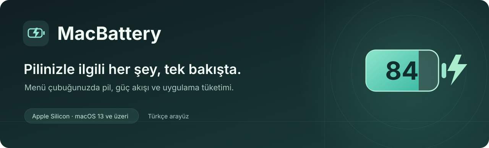
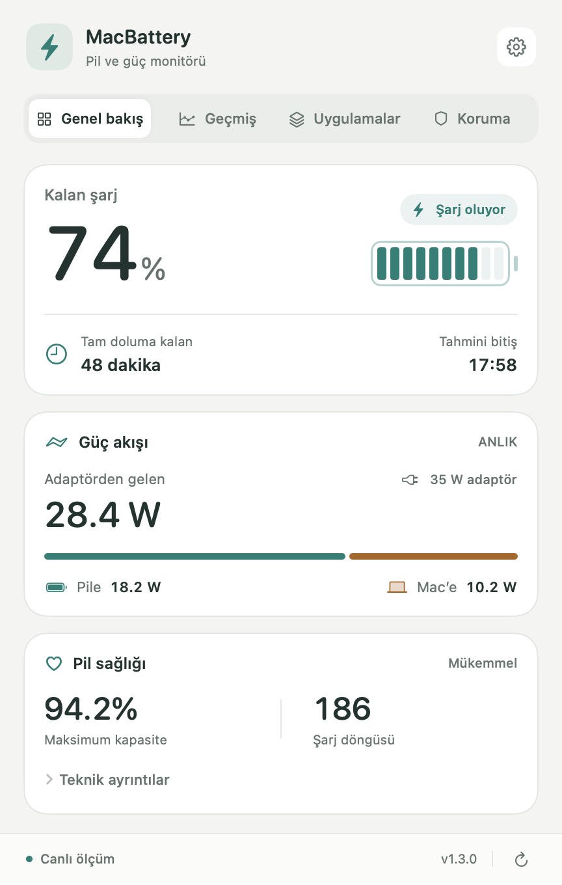
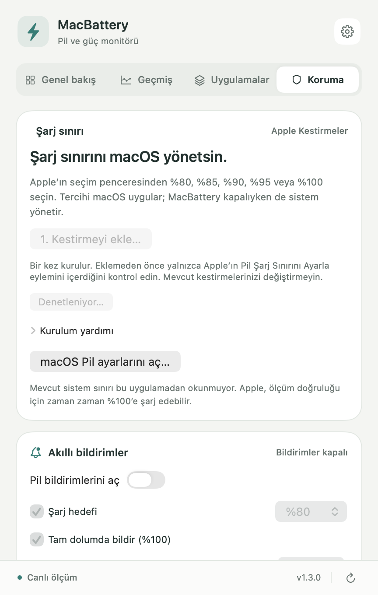

<strong>Türkçe</strong> · <a href="README.en.md">English</a>

<strong>MacBook’unuzun pilini, güç akışını ve uygulama tüketimini tek bir menü çubuğu panelinde takip edin.</strong>

<!-- DOWNLOADS:START -->

<strong>Kararlı 1.3.0</strong> · <a href="https://github.com/Enes-Somuncular/MacBattery-Releases/releases/tag/v1.3.0">Sürüm notları</a> · <a href="https://github.com/Enes-Somuncular/MacBattery-Releases/releases/download/v1.3.0/SHA256SUMS">SHA256</a> <a href="https://github.com/Enes-Somuncular/MacBattery-Releases/releases/download/v1.4.0-beta.2/MacBattery-1.4.0-beta.2.dmg">Betayı dene · 1.4.0-beta.2</a> — Deneme sürümü

<!-- DOWNLOADS:END -->

> **İlk kurulum hakkında:** Mevcut dağıtım henüz Apple Developer ID ile imzalanmış ve noter onayından geçirilmiş değildir. macOS ilk açılışı engelleyebilir. [Kurulum ve macOS uyarıları →](docs/INSTALL.md)

## Tek panel, daha net bir görünüm

| Açık görünüm | Koyu görünüm |
| :---: | :---: |
|  |  |

Kararlı 1.3.0 arayüzü, uygulamanın kendi ekranlarından örnek verilerle üretilmiştir. Görsellerdeki değerler temsilidir.

## Kararlı sürümde neler var?

| Özellik | Ne sağlar? |
| :--- | :--- |
| **Pil ve sağlık özeti** | Pil yüzdesi, dolum/kullanım süresi tahmini, döngü sayısı ve kapasite bilgileri. |
| **Güç akışı** | Adaptör girişi, pil şarjı ve Mac tüketimini anlaşılır bir dağılımla izleme. Güç değerleri tahmin içerebilir. |
| **Anlık geçmiş** | Son 30 veya 60 saniyelik güç grafiği; imleçle değer inceleme. |
| **Uygulama görünümü** | Uygulamalara göre CPU, bellek ve tahmini enerji tüketimi; arama ve sıralama. |
| **Pil koruması** | İsteğe bağlı şarj hedefi, tam dolum ve düşük pil bildirimleri. |
| **Apple’ın şarj sınırı** | Desteklenen Mac’lerde Apple Kestirmeler üzerinden %80–100 seçimi. |
| **Uygulama içi güncelleme** | Yeni sürümü indirme, imza doğrulama ve yeniden başlatma. Ayrı kararlı/beta kanalları. |

| Uygulama tüketimi | Pil koruması |
| :---: | :---: |
|  |  |

**Şarj sınırı için:** Apple Silicon ve macOS 26.4 veya üzeri gerekir. İlk kullanımda hazır kestirme bir kez eklenir. Bildirim hedefi şarj sınırından ayrıdır; bildirim göndermek şarjı durdurmaz. Uygulama watt sınırı veya zorla deşarj uygulamaz.

## İndir, taşı, aç

1. Yukarıdaki **Mac için kararlı sürümü indir** düğmesine tıklayın ve DMG dosyasını açın.
2. **MacBattery** uygulamasını **Uygulamalar / Applications** klasörüne sürükleyin.
3. Uygulamalar’daki MacBattery’yi açın; paneline menü çubuğundan ulaşın.

**Gereksinimler:** Apple Silicon işlemcili MacBook · macOS 13 veya üzeri · Türkçe arayüz. Intel paketi sunulmuyor. Güncellemelerin çalışması için uygulamayı DMG’nin içinden değil, Uygulamalar klasöründen çalıştırın.

[Adım adım kurulum](docs/INSTALL.md) · [Sık sorulan sorular](docs/FAQ.md) · [Sorun bildir](https://github.com/Enes-Somuncular/MacBattery-Releases/issues/new/choose)

## Beta kanalında bir adım önde

Yeni özellikler önce beta olarak sunulur. **Ayarlar → Güncellemeler → Beta güncellemelerini al** seçeneğiyle denemeye katılabilirsiniz. Beta hatalar içerebilir; kapatmak yüklü sürümü otomatik olarak eski bir sürüme düşürmez.

**1.4.0 beta serisinden önizlemeler:**

- **Pil günlüğü:** Bugün/son 7 gün özeti, kalıcı pil yüzdesi grafiği, gözlenen pille/adaptörde kullanım süreleri ve tahmini enerji. Kayıtlar bu Mac’te en fazla 30 gün saklanır; duraklatılabilir ve silinebilir.
- **Yeni menü çubuğu:** Pil içinde yüzde, aktif şarj için mini şimşek ve adaptörde bekleme için mini fiş.

Pil günlüğünün beta önizlemesini göster

Bu bölüm beta özelliklerini gösterir; kararlı 1.3.0 paketinin ekranlarıyla karıştırılmamalıdır. Görseller örnek veriler içerir.

## Güncellemeler ve gizlilik

- Yeni sürümler varsayılan olarak altı saatte bir denetlenir. Menüden **Güncellemeleri Denetle…** ile elle de kontrol edebilirsiniz.
- Güncelleme ZIP’i ve güncelleme akışı **Ed25519** ile doğrulanır. Bu doğrulama, Apple Developer ID / noter onayının yerine geçmez.
- Pil ölçümleri ve uygulama listesi MacBattery tarafından sunucuya gönderilmez. Güncelleme denetimleri ve dosya indirmeleri GitHub üzerinden yapılır.
- Beta pil günlüğü bu Mac’te tutulur; uygulama kapalıyken veya Mac uykudayken eksik süreler uydurulmaz.

## Bu depoda ne bulunuyor?

Burası MacBattery’nin **herkese açık indirme ve tanıtım deposudur**. Uygulamanın kaynak kodu özel depoda tutulur; burada paylaşılmaz.

Releases içindeki DMG uygulamayı kurmak, ZIP uygulama içi güncelleme için kullanılır. `SHA256SUMS` dosya kontrol toplamlarını içerir. GitHub’ın otomatik oluşturduğu **“Source code (zip/tar.gz)”** arşivleri yalnızca bu yayın deposunun tanıtım dosyalarını ve görsellerini içerir; MacBattery’nin uygulama kaynak kodlarını içermez. Kurulum için bunları indirmeyin.

---

<a href="https://github.com/Enes-Somuncular/MacBattery-Releases/releases/latest">Tüm kararlı sürüm dosyaları</a> · <a href="https://github.com/Enes-Somuncular/MacBattery-Releases/releases">Yayın geçmişi</a> · <a href="https://github.com/Enes-Somuncular/MacBattery-Releases/issues/new/choose">Geri bildirim</a>

