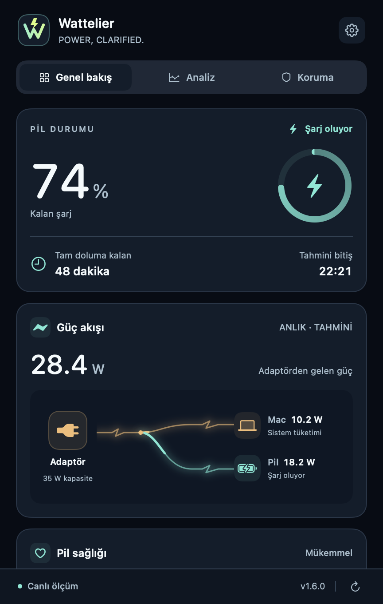
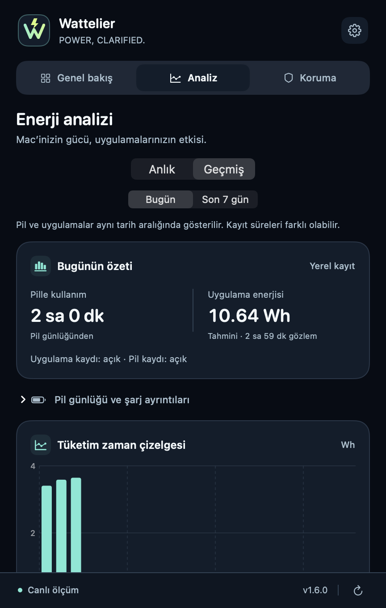

<strong>Türkçe</strong> · <a href="README.en.md">English</a>

# Wattelier

**Power, clarified. · Pil yüzdesinin ötesini gör.**

Mac’inin enerjisi nereye gidiyor? Şarjını, güç akışını ve uygulamalarının etkisini menü çubuğundan takip et.

**[↓ Wattelier 1.6.0’ı indir](https://github.com/Enes-Somuncular/Wattelier-Releases/releases/download/v1.6.0/Wattelier-1.6.0.dmg)** · [Sürüm notları](https://github.com/Enes-Somuncular/Wattelier-Releases/releases/tag/v1.6.0) · [Tüm sürümler](https://github.com/Enes-Somuncular/Wattelier-Releases/releases)

Apple Silicon · macOS 13+ · Türkçe arayüz · Açık ve koyu görünüm

## 1.6.0 ile daha anlaşılır enerji

**Genel bakış → Analiz → Koruma.** Üç sade bölüm; bir bakışta durum, ihtiyaç duyduğunda ayrıntı.

| Genel bakış | Birleşik Analiz |
| :---: | :---: |
|  |  |

Gerçek 1.6.0 arayüzünden, örnek verilerle hazırlanmış görseller.

### Gücü hareket halinde gör

Adaptörden çıkan elektrik hattı Mac’e ve şarj olan pile ayrılır. Kehribar hat sistem tüketimini, turkuaz hat pil şarjını gösterir. Pil doluyken veya şarj beklemedeyken pil kolu sönük kalır; pille çalışırken tek hat görünür. Adaptör kapasitesi ile anlık giriş gücü ayrı gösterilir.

Kart geçişleri, kayan sekme seçimi ve kısa etkileşim animasyonları arayüzü akıcı tutar. macOS’un **Hareketi Azalt** tercihi desteklenir; elektrik akışı animasyonu pencere kapalıyken durur.

### Uygulamalar ve geçmiş, aynı yerde

| Bölüm | Neler görebilirsin? |
| --- | --- |
| **Genel bakış** | Pil yüzdesi, şarj durumu, kalan süre tahmini, güç dağılımı, sağlık ve şarj döngüsü. |
| **Analiz · Anlık** | Çalışan uygulamaların CPU, RAM ve tahmini Watt kullanımı; arama, sıralama ve son 30/60 saniyenin güç grafiği. |
| **Analiz · Geçmiş** | Ortak **Bugün / Son 7 gün** filtresi, pille kullanım özeti, tahmini uygulama enerjisi (Wh), uygulama karşılaştırmaları ve ayrıntılı pil günlüğü. |
| **Koruma** | Şarj hedefi ve düşük pil hatırlatmaları; desteklenen sistemlerde, düğmeye bastığında çalışan Apple Kestirmesiyle şarj sınırı seçimi. |

### Gerektiğinde bildirim, tekrar eden uyarılar olmadan

Tam dolum uyarısı macOS’un gerçek tam dolum durumunu bekler. Uygulama zaten dolu pille açılırsa sessiz kalır. Tekrar engeli yeniden açılışta ve tercih değişikliklerinde korunur; yeni bir tam dolum uyarısı için pilin önce **%95 veya altına** düşmesi gerekir. Koruma ekranındaki **Test bildirimi gönder** düğmesiyle bildirimlerini kontrol edebilirsin.

## İndir ve kur

1. **[Wattelier 1.6.0 DMG](https://github.com/Enes-Somuncular/Wattelier-Releases/releases/download/v1.6.0/Wattelier-1.6.0.dmg)** dosyasını indir ve aç.
2. Wattelier’i **Applications / Uygulamalar** klasörüne sürükle.
3. Uygulamayı bu klasörden aç; menü çubuğundaki pil simgesine tıkla.

**Zaten kullanıyorsan:** Uygulamadan **Güncellemeleri Denetle** seçeneğini kullan. Beta 3 kullanıcılarına da 1.6.0 kararlı güncellemesi sunulur. Güncelleme kanalını **Ayarlar → Güncellemeler → Kararlı** olarak seçebilirsin.

[ZIP paketi](https://github.com/Enes-Somuncular/Wattelier-Releases/releases/download/v1.6.0/Wattelier-1.6.0.zip) · [SHA256 doğrulama dosyası](https://github.com/Enes-Somuncular/Wattelier-Releases/releases/download/v1.6.0/SHA256SUMS) · [Kurulum rehberi](docs/INSTALL.md) · [Sorun bildir](https://github.com/Enes-Somuncular/Wattelier-Releases/issues/new/choose)

**Gereksinimler:** Apple Silicon MacBook, macOS 13 veya üzeri. Intel sürümü yoktur. Uygulama ad-hoc imzalıdır; Apple Developer ID / notarization henüz yoktur. İlk açılışta macOS onayı gerekebilir; ayrıntılar kurulum rehberindedir.

## Verilerin bu Mac’te kalır

- Pil ve uygulama geçmişi yalnızca bu Mac’te, en fazla **30 gün** saklanır.
- Uygulama geçmişi varsayılan olarak **kapalıdır**. Kaydı açabilir, duraklatabilir veya geçmişi silebilirsin.
- Pil ölçümleri ve açık uygulama listesi sunucuya gönderilmez. Güncelleme denetimleri ve indirmeler GitHub üzerinden yapılır.
- Watt ve Wh değerleri **tahminidir**. Uygulama enerjisi CPU payıyla modellenir; GPU, ekran ve bütün arka plan yükleri uygulamalara kesin olarak dağıtılamaz. Eksik ölçümler ve uyku süreleri kaydedilmiş kullanım gibi sayılmaz.
- Şarj hatırlatma hedefi gerçek şarj sınırı değildir. Apple Kestirmesi yalnızca sen başlattığında çalışır; uygulama mevcut sistem şarj sınırını okumaz.

## Beta kanalı ve eski kurulumlar

Yeni deneme sürümlerini almak için **Ayarlar → Güncellemeler → Beta** kanalını seç. 1.6.0, onaylanan Beta 3 kodunun kararlı kimlikle yeniden derlenmiş sürümüdür; önceki betalar [sürüm arşivinde](https://github.com/Enes-Somuncular/Wattelier-Releases/releases) kalır. Beta kanalını kapatmak otomatik sürüm düşürmez.

Görünen ürün adı **Wattelier**’dir. Eski MacBattery kurulumlarının tercihlerini, geçmişini ve Sparkle güncellemelerini korumak için iç paket yolu **MacBattery.app** ve uygulama kimliği korunur. Yeni indirmeler **Wattelier-VERSION.dmg / .zip** adını taşır; eski indirmeler erişilebilir kalır.

Bu depo **indirme ve ürün dokümantasyonu** içindir; uygulamanın kaynak kodu özeldir. GitHub’ın otomatik **Source code (zip/tar.gz)** dosyaları kurulum paketi değildir. Uygulamayı kurmak için DMG veya uygulama ZIP’ini kullan.

---

[Son kararlı sürüm](https://github.com/Enes-Somuncular/Wattelier-Releases/releases/latest) · [SSS](docs/FAQ.md) · [Marka rehberi](docs/BRAND.md) · [Geri bildirim](https://github.com/Enes-Somuncular/Wattelier-Releases/issues/new/choose)

Wattelier · Power, clarified. · Enes Somuncular

