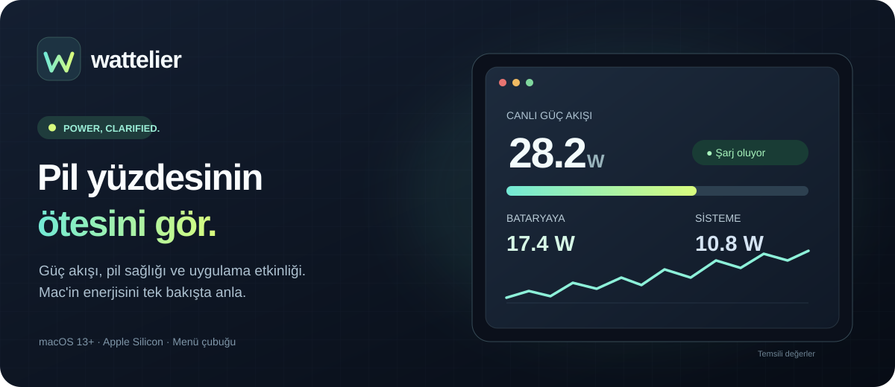
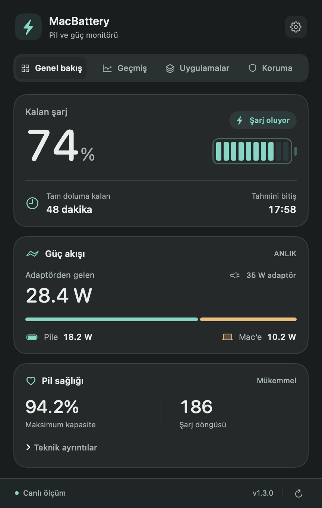
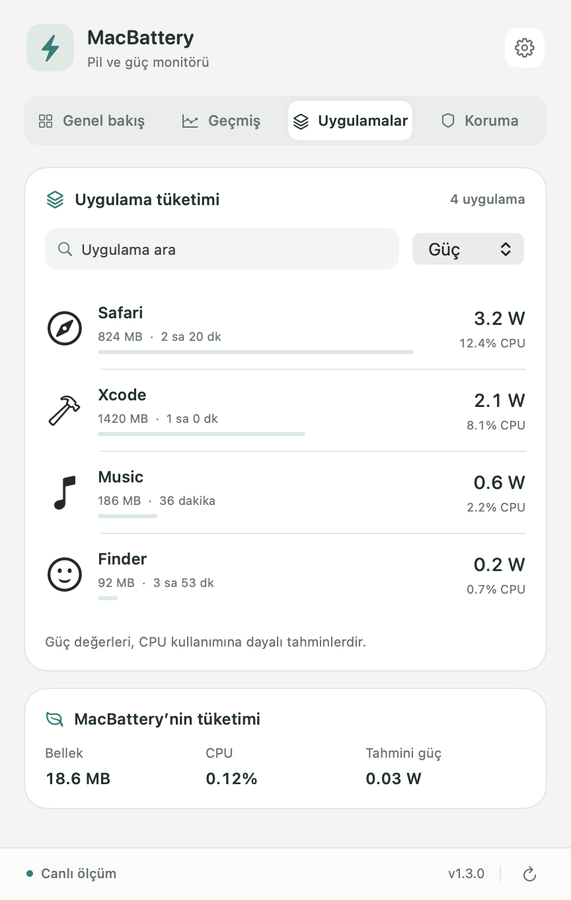
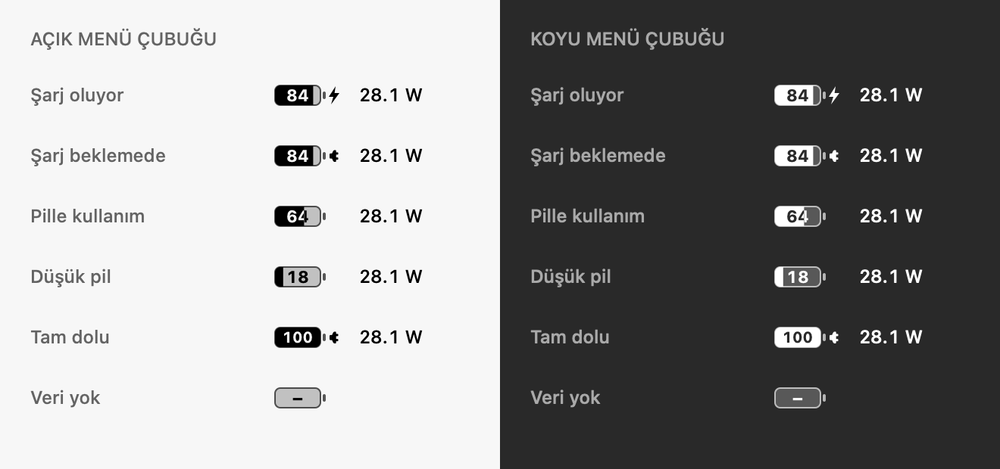
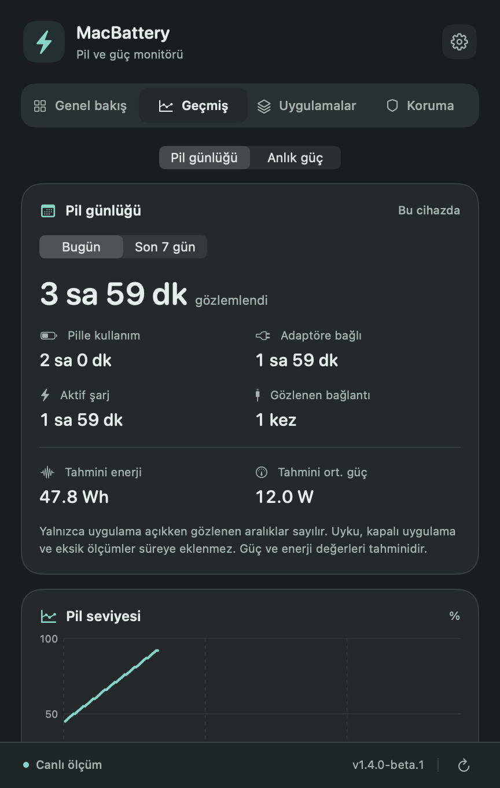

<strong>Türkçe</strong> · <a href="README.en.md">English</a>

# wattelier
### Power, clarified.

**Pil yüzdesinin ötesini gör.**  
Mac'in güç akışını, pil sağlığını ve uygulama etkinliğini tek bakışta anla.

[Özellikler](#-güç-bir-bakışta) · [Kurulum](#-üç-adımda-kurulum) · [Beta](#-beta-kanalı) · [SSS](docs/FAQ.md)

---

## ⬇️ Mac için indir

> **Yeni marka: Wattelier.** Geçiş döneminde uygulamanın adı ve DMG dosyaları **MacBattery** olarak kalır. Mevcut kullanıcıların güncelleme akışı korunur.

<!-- DOWNLOADS:START -->

| **✦ Kararlı sürüm · 1.4.1** | **◇ Beta sürümü · 1.4.1-beta.2** |
| :---: | :---: |
| Günlük kullanım için önerilen sürüm | Yeni özellikler ve erken testler |
| **[↓ Mac için kararlı sürümü indir](https://github.com/Enes-Somuncular/MacBattery-Releases/releases/download/v1.4.1/MacBattery-1.4.1.dmg)** | **[↓ Beta sürümünü indir](https://github.com/Enes-Somuncular/MacBattery-Releases/releases/download/v1.4.1-beta.2/MacBattery-1.4.1-beta.2.dmg)** |
| [Sürüm notları](https://github.com/Enes-Somuncular/MacBattery-Releases/releases/tag/v1.4.1) · [SHA256](https://github.com/Enes-Somuncular/MacBattery-Releases/releases/download/v1.4.1/SHA256SUMS) | [Beta notları](https://github.com/Enes-Somuncular/MacBattery-Releases/releases/tag/v1.4.1-beta.2) · [SHA256](https://github.com/Enes-Somuncular/MacBattery-Releases/releases/download/v1.4.1-beta.2/SHA256SUMS) |

<!-- DOWNLOADS:END -->

**[Tüm sürümler ve indirme geçmişi →](https://github.com/Enes-Somuncular/MacBattery-Releases/releases)**

**Destek:** Apple Silicon işlemcili MacBook · macOS 13 ve üzeri · Intel sürümü yok.  
**Önemli:** İndirilen paketler ad-hoc imzalıdır; Apple Developer ID imzası / noter onayı henüz bulunmuyor. macOS ilk açılış için onay isteyebilir. [Güvenli kurulum rehberi →](docs/INSTALL.md)

## ✨ Güç, bir bakışta

| Özellik | Ne sunar? |
| --- | --- |
| **⚡ Güç akışı** | Adaptör girişi, bataryaya aktarılan güç ve tahmini Mac yükünü gör. |
| **📈 Canlı grafik** | Son 30/60 saniyelik güç değişimlerini incele. |
| **◉ Pil sağlığı** | Pil yüzdesi, kapasite, döngü sayısı ve şarj durumunu takip et. |
| **⌘ Uygulama etkinliği** | CPU, RAM ve uygulama başına **tahmini** enerji kullanımını karşılaştır. |
| **◷ Pil günlüğü** | Pil yüzdesi geçmişi ve gözlenen günlük / haftalık kullanım süreleri. |
| **🛡️ Pil koruması** | İsteğe bağlı bildirimler; desteklenen Mac'lerde Apple Kestirmeler üzerinden şarj sınırı. |
| **⟳ Güncelleme kanalları** | Uygulama içinden kararlı ve beta sürümlerini takip et. |

Güç dağılımı ve uygulama başına Watt değerleri tahmindir; doğrudan elektrik sayacı ölçümü değildir. Dolum süresi macOS telemetrisine göre değişir veya güvenilir bilgi yoksa gizlenebilir.

## ◇ Mac'in için tasarlandı

| Gerçek uygulamadan koyu görünüm | Uygulama etkinliği |
| :---: | :---: |
|  |  |

Görseller önceki kararlı 1.3.0 arayüzünden, temsili verilerle hazırlanmıştır. En yeni 1.4.1 sürümünün arayüzü farklılaşabilir.

## 📦 Üç adımda kurulum

1. Yukarıdaki **kararlı sürümün DMG** dosyasını indir ve aç.
2. **MacBattery.app** uygulamasını **Applications / Uygulamalar** klasörüne sürükle.
3. Uygulamayı Applications içinden aç; menü çubuğundaki pil simgesine tıkla.

[Adım adım kurulum ve macOS güvenlik uyarıları](docs/INSTALL.md) · [Sorun bildir](https://github.com/Enes-Somuncular/MacBattery-Releases/issues/new/choose)

## ◇ Beta kanalı

Yeni özellikleri önce denemek için **Ayarlar → Güncellemeler → Beta güncellemelerini al** seçeneğini aç. Bu seçeneği kapatmak, yüklü sürümü otomatik olarak eski bir kararlı sürüme düşürmez.

<strong>Beta önizlemelerini göster</strong>

**Menü çubuğu tasarımları** · 1.4.0 beta serisinden örnekler

**Pil günlüğü** · örnek veriler

## 🔐 Gizlilik ve şeffaflık

Pil ölçümleri ve açık uygulama listesi sunucuya yüklenmez; güncelleme denetimleri ile indirmeler GitHub üzerinden gerçekleştirilir. Yerel pil günlüğünün saklanma süresi ve kontrol seçenekleri [SSS](docs/FAQ.md) bölümünde açıklanır. Güncellemelerde kullanılan Ed25519 imzaları, Apple'ın notarization sürecinin yerine geçmez.

Bu depo **herkese açık tanıtım ve indirme deposudur**; uygulamanın Swift kaynak kodlarını içermez. GitHub'ın otomatik ürettiği **Source code (zip/tar.gz)** arşivleri kurulum paketi **değildir**. Uygulamayı kurmak için DMG indir.

---

[Web indirme sayfası kaynağı](site/index.html) · [Tüm sürümler](https://github.com/Enes-Somuncular/MacBattery-Releases/releases) · [SSS](docs/FAQ.md) · [Marka rehberi](docs/BRAND.md) · [Geri bildirim](https://github.com/Enes-Somuncular/MacBattery-Releases/issues/new/choose)

Wattelier · Power, clarified. · Enes Somuncular

